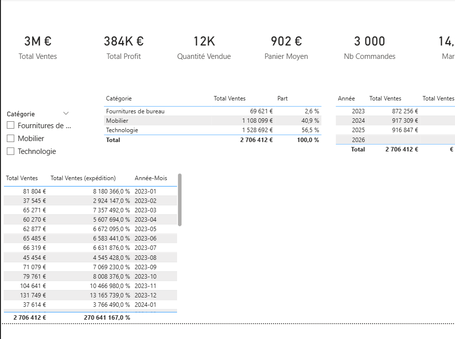
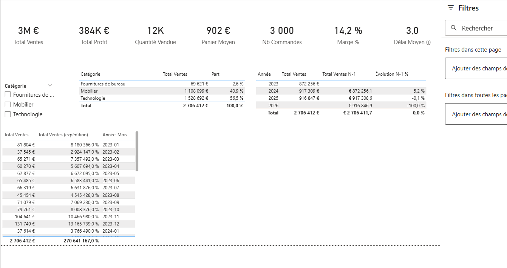
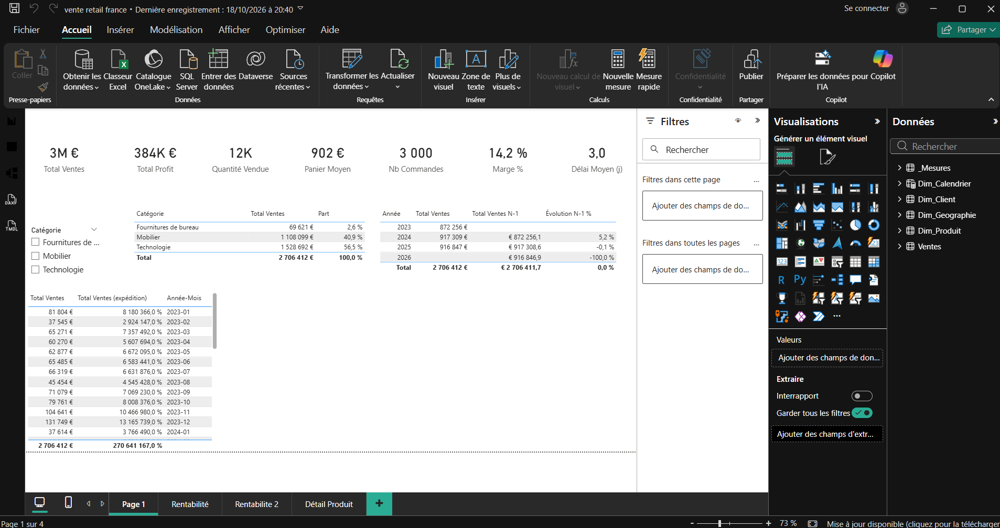
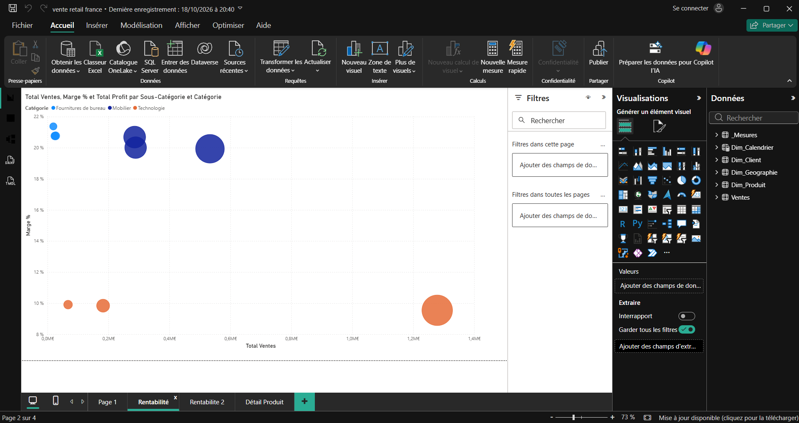
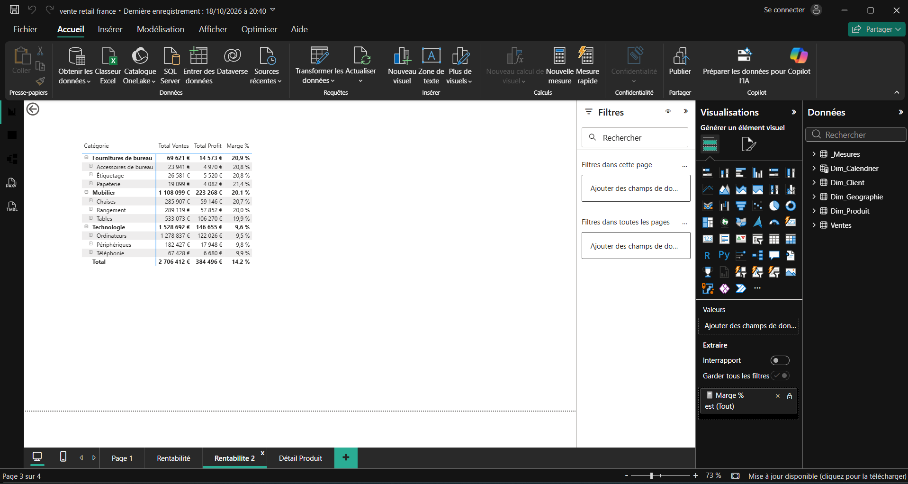

# powerbi-sales-dashboard : analyse de la rentabilité des ventes retail France

Projet d'apprentissage de Power BI Desktop (semaine 12). À partir d'un fichier Excel de ventes, construction d'un modèle en étoile, d'un calendrier DAX, de mesures et d'un rapport d'analyse de la rentabilité.

## Objectifs

- Importer et nettoyer un fichier Excel avec Power Query.
- Construire un schéma en étoile (table de faits, dimensions, calendrier).
- Écrire des mesures DAX : base, intelligence temporelle, objectifs.
- Répondre à une question métier : où se situe la rentabilité ?

## Jeu de données

| Élément | Valeur |
|---|---|
| Fichier | `data/ventes_retail_france.xlsx` (feuille `Ventes`) |
| Volume | 3 000 commandes, 15 colonnes |
| Période | 01/01/2023 au 27/12/2025 |
| Dimensions | 3 catégories, 9 sous-catégories, 26 produits, 8 régions, 24 villes, 3 segments clients |
| Qualité | Aucune valeur manquante ni doublon ; `Ventes = Quantité x Prix x (1 - Remise)` vérifié sur toutes les lignes |

## Modèle de données

```
            Dim_Calendrier
              |  Date -> Date Commande     (relation active)
              |  Date -> Date Expédition   (relation inactive)
Dim_Produit -- Ventes (faits) -- Dim_Geographie

Objectifs (table saisie, sans relation, lue via LOOKUPVALUE)
```

- **Ventes** : table de faits, une ligne par commande.
- **Dim_Produit** (Produit, Sous-Catégorie, Catégorie) et **Dim_Geographie** (Ville, Région) : créées par référence dans Power Query.
- **Dim_Calendrier** : table de dates DAX continue (2023 à 2026), marquée comme table de dates. Elle va jusqu'en 2026 car la dernière expédition a lieu le 01/01/2026.
- **Objectifs** : marge cible par catégorie (valeurs d'exemple).

Le code Power Query et les mesures DAX sont détaillés dans [`dax/modele_dax_et_power_query.md`](dax/modele_dax_et_power_query.md).

## Mesures principales

| Mesure | Rôle |
|---|---|
| `Total Ventes`, `Total Profit` | Sommes de base |
| `Marge %` | Profit divisé par ventes |
| `Nb Commandes`, `Panier Moyen`, `Quantité Vendue`, `Délai Moyen (j)` | Indicateurs de base |
| `Part du CA % (ALL)` | Part de chaque catégorie dans le CA |
| `Total Ventes N-1`, `Évolution N-1 %`, `Total Ventes YTD` | Comparaison dans le temps |
| `Total Ventes (expédition)` | CA selon la date d'expédition (`USERELATIONSHIP`) |
| `Marge Cible %`, `Écart Marge`, `Statut Marge`, `Profit Cible`, `Écart Profit` | Suivi des objectifs |

## Pages du rapport

1. **Vue d'ensemble** : cartes d'indicateurs, part du CA par catégorie, comparaison avec l'année précédente.
2. **Rentabilité** : nuage de points CA / marge par sous-catégorie, matrice Catégorie vers Produit avec couleurs, suivi des objectifs.
3. **Détail Produit** : page de drill-through filtrée sur un produit.





### Captures complémentaires




## Résultats clés

- CA total d'environ 2,71 M€, profit d'environ 384 k€, marge d'environ 14,2 %.
- CA stable d'une année sur l'autre (environ 872 k€ en 2023, 917 k€ en 2024 et en 2025).
- La **Technologie** pèse environ 56 % du CA pour une marge d'environ 9,6 %, contre environ 20 % pour le Mobilier et les Fournitures.
- Aucune sous-catégorie n'est déficitaire : l'écart de rentabilité vient du poids de la Technologie.
- Avec un objectif d'exemple de 12 % en Technologie, l'écart de profit est d'environ -36,8 k€.

## Limites

- Pas d'identifiant client : pas d'analyse de fidélité ni de cohortes.
- Pas de coûts détaillés, de stocks ni de retours : on constate l'écart de marge sans pouvoir l'expliquer.
- Les objectifs de marge sont des valeurs d'exemple, pas des objectifs réels.
- Une variante de la part du CA avec `ALLSELECTED` n'a pas fonctionné ; la version avec `ALL` a été retenue.

## Structure du dépôt

```
powerbi-sales-dashboard/
├── README.md
├── .gitignore
├── dashboard/     rapport Power BI (ventes_retail_france.pbix)
├── data/          fichier source Excel
├── dax/           code Power Query et mesures DAX
├── screenshots/   captures des pages du rapport
└── docs/          mémo de concepts
```

## Utilisation

1. Cloner le dépôt.
2. Ouvrir `dashboard/ventes_retail_france.pbix` dans Power BI Desktop (Windows).
3. Si l'actualisation échoue : **Accueil, Transformer les données, Paramètres de la source de données**, puis pointer vers `data/ventes_retail_france.xlsx`.

## Documentation

- [`dax/modele_dax_et_power_query.md`](dax/modele_dax_et_power_query.md) : code du modèle (Power Query, relations, mesures DAX).
- [`docs/memo_powerbi_ventes_retail_france.md`](docs/memo_powerbi_ventes_retail_france.md) : mémo de concepts (Power Query, modèle en étoile, calendrier, DAX).

## Auteur

Vladimir : [GitHub](https://github.com/Vladimirviho)